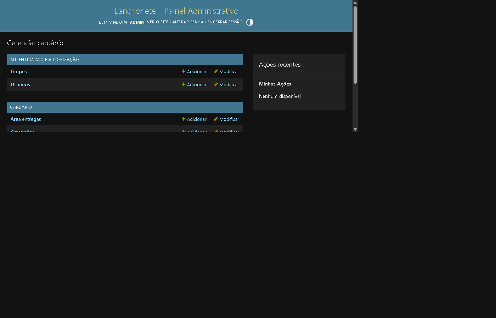
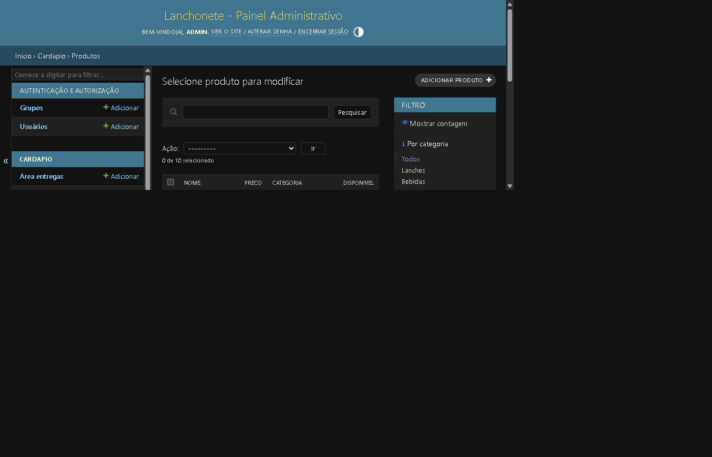
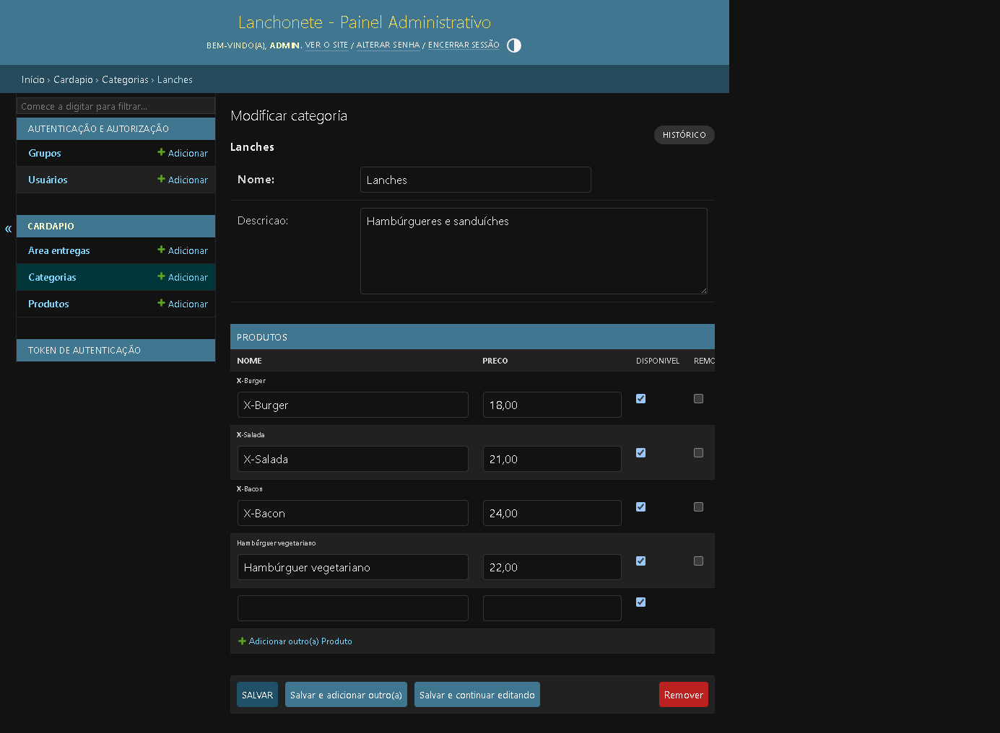
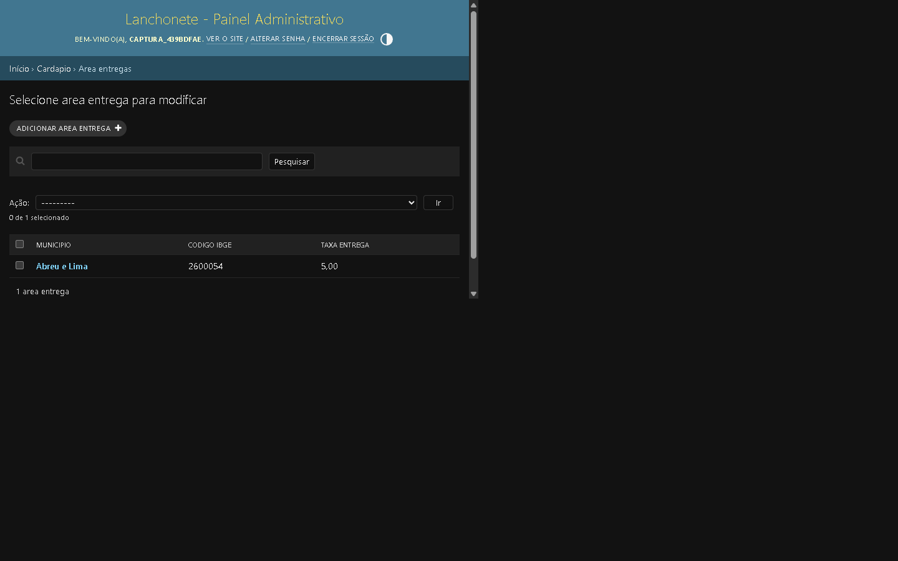
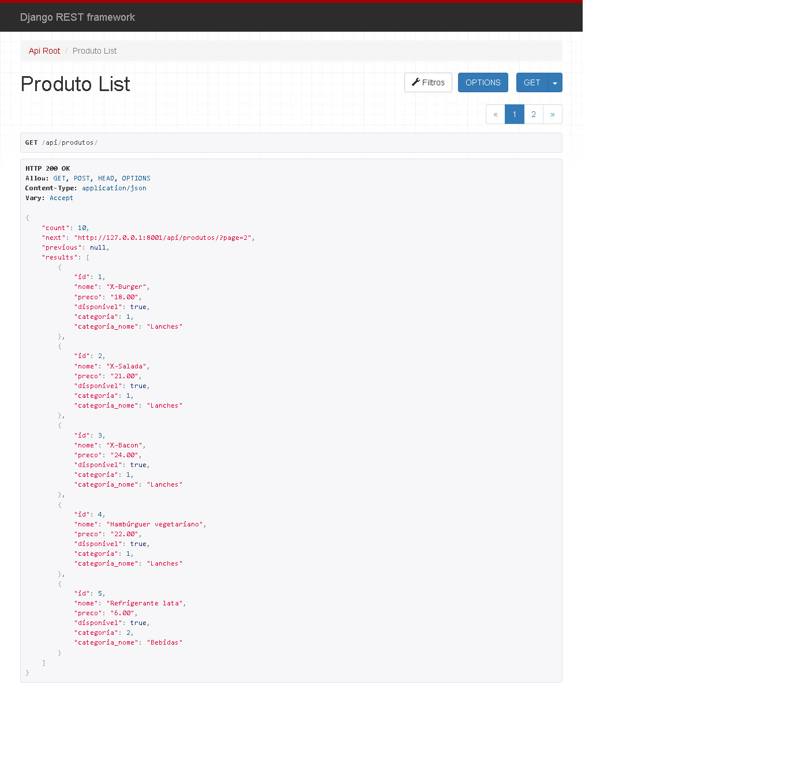
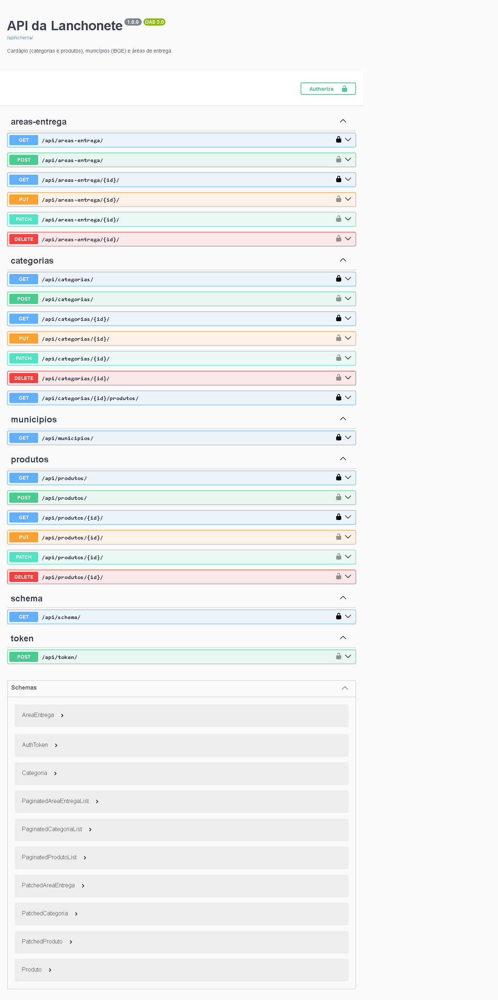
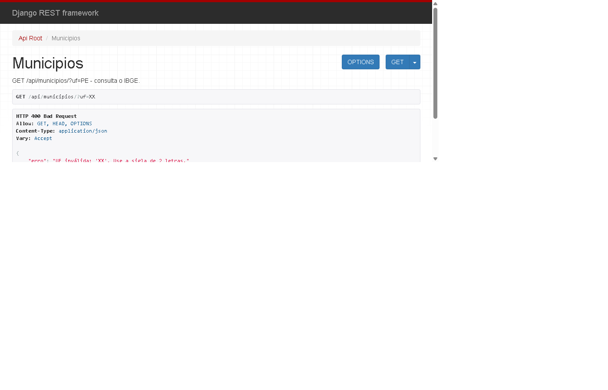
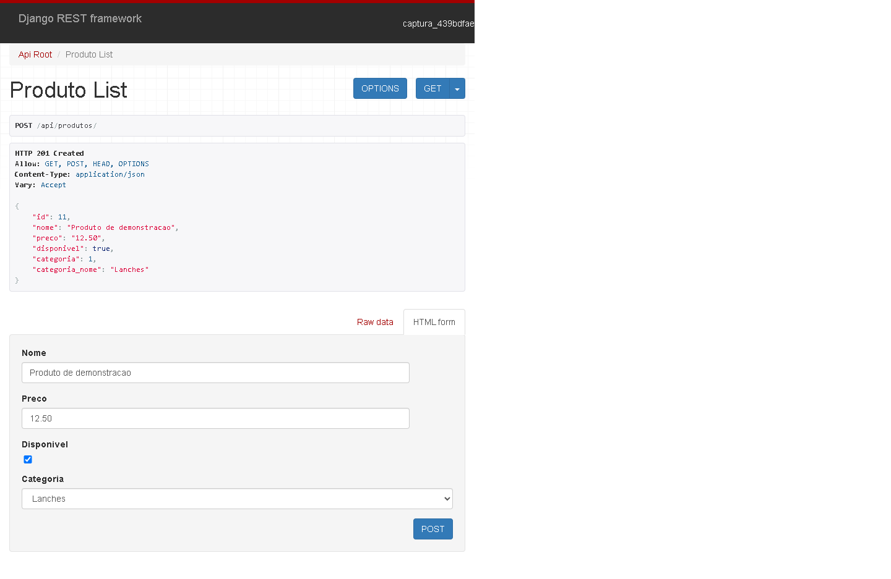
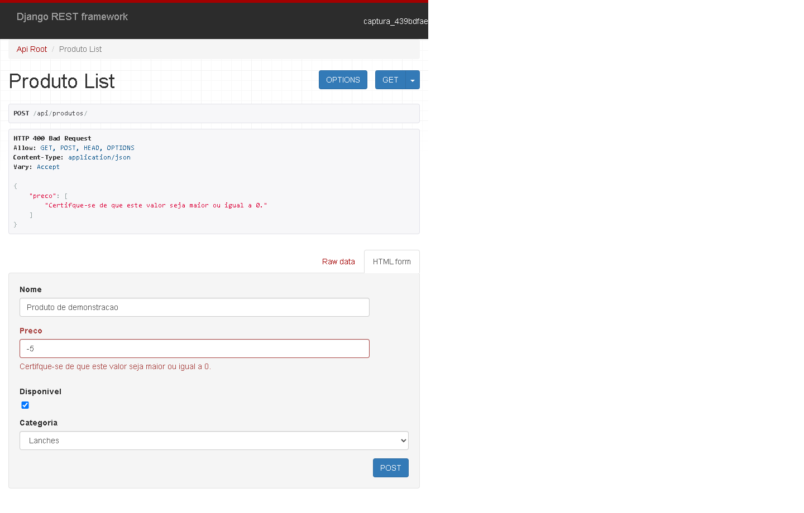
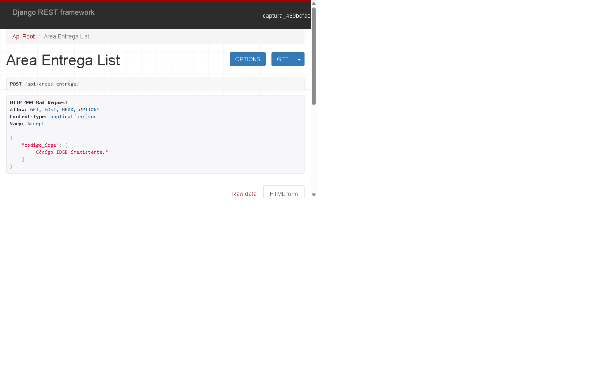

# API da Lanchonete

**Aluno(a):** Yan Matheus
**Curso:** Senac | Instrutor: Carlos Celestino

## 1. Apresentação

A API da Lanchonete é um projeto feito em Django e Django REST Framework para organizar o cardápio de uma lanchonete de bairro. O dono usa o painel administrativo (Django Admin) para cadastrar categorias e produtos no dia a dia, e a API devolve esses dados em JSON para que, no futuro, um site ou aplicativo de pedidos possa consumi-los. O projeto também tem um extra: um endpoint que consulta a API pública do IBGE para listar os municípios de um estado, e um cadastro de áreas de entrega validado com os códigos do IBGE.

## 2. Tecnologias

- **Python:** linguagem em que todo o projeto é escrito.
- **Django:** framework web que cuida dos models, do banco de dados, das migrações e do painel admin.
- **Django REST Framework (DRF):** extensão do Django para criar APIs REST (serializers, viewsets e routers).
- **SQLite:** banco de dados simples, em arquivo, usado em desenvolvimento.
- **drf-spectacular:** gera a documentação automática da API (Swagger).
- **Autenticação por token (`rest_framework.authtoken`):** permite que só quem tem token consiga criar, editar e excluir dados pela API.
- **requests:** biblioteca para fazer chamadas HTTP, usada para consultar a API do IBGE.
- **Git e GitHub:** controle de versão e hospedagem do código.

## 3. Como rodar o projeto

1. Clonar o repositório e entrar na pasta:

```
git clone https://github.com/yanmatheusdev/lanchonete_atividade_senacfullstack.git
cd lanchonete_atividade_senacfullstack
```

2. Criar e ativar o ambiente virtual:

```
python -m venv venv
venv\Scripts\activate          # Windows
source venv/bin/activate       # Linux / macOS
```

3. Instalar as dependências:

```
pip install -r requirements.txt
```

4. Aplicar as migrações (cria as tabelas no banco):

```
python manage.py migrate
```

5. Carregar os dados de exemplo (3 categorias e 10 produtos) e criar um superusuário:

```
python manage.py loaddata cardapio.json
python manage.py createsuperuser
```

6. Iniciar o servidor:

```
python manage.py runserver
```

7. Acessar:

- API: http://127.0.0.1:8000/api/
- Admin: http://127.0.0.1:8000/admin/
- Documentação (Swagger): http://127.0.0.1:8000/api/docs/

Para criar/editar/excluir pela API é preciso de um token. Para gerar um token para um usuário existente:

```
python manage.py drf_create_token NOME_DO_USUARIO
```

Depois, enviar o cabeçalho `Authorization: Token SEU_TOKEN` nas requisições.

## 4. Estrutura do projeto

```
lanchonete_atividade_senacfullstack/
├── manage.py
├── requirements.txt
├── cardapio.json
├── lanchonete/
│   ├── settings.py
│   └── urls.py
└── cardapio/
    ├── models.py
    ├── serializers.py
    ├── views.py
    ├── urls.py
    ├── admin.py
    └── ibge.py
```

- **`manage.py`:** arquivo usado para rodar comandos do Django (runserver, migrate, createsuperuser etc.).
- **`settings.py`:** configurações do projeto: apps instalados, banco de dados, idioma e as configurações do DRF (paginação, autenticação e permissões).
- **`urls.py` (da pasta `lanchonete`):** mapa principal de URLs. Liga `/admin/`, `/api/token/`, `/api/docs/` e `/api/` aos lugares certos.
- **`urls.py` (da pasta `cardapio`):** cria o router que registra os viewsets e adiciona a rota de municípios.
- **`models.py`:** define as tabelas do banco como classes Python: `Categoria`, `Produto` e `AreaEntrega`.
- **`serializers.py`:** converte os models em JSON e o JSON em dados válidos, além de validar (por exemplo, o preço e o código do IBGE).
- **`views.py`:** tem a lógica da API: os viewsets de categoria, produto e área de entrega, e a view que consulta os municípios.
- **`admin.py`:** configura como os models aparecem no Django Admin (colunas, filtros, busca, inline e action).
- **`ibge.py`:** funções que conversam com a API do IBGE, com `timeout`.

## 5. Conceitos

- **API REST:** uma forma de dois sistemas conversarem pela internet usando HTTP, em que cada recurso (como "produtos") tem uma URL e as ações são feitas com métodos HTTP. Os dados costumam ir em JSON.
- **Model:** uma classe Python que representa uma tabela do banco. Cada atributo vira uma coluna. Ex.: `Produto` com `nome`, `preco`, `disponivel` e `categoria`.
- **Serializer:** converte um objeto do Django em JSON (e o contrário) e valida os dados que chegam.
- **ViewSet:** reúne em uma classe as ações de um recurso (listar, detalhar, criar, editar, excluir). Com `ModelViewSet` o CRUD já vem pronto.
- **Router:** gera automaticamente as URLs de um viewset. Eu registrei `categorias` e `produtos` no `DefaultRouter`.
- **GET:** busca dados.
- **POST:** cria um dado novo.
- **PUT:** substitui um registro inteiro (precisa mandar todos os campos).
- **PATCH:** altera só alguns campos de um registro.
- **DELETE:** remove um registro.

## 6. Endpoints da API

| Endpoint | Método | O que faz |
|---|---|---|
| `/api/categorias/` | GET | Lista as categorias |
| `/api/categorias/` | POST | Cria uma categoria |
| `/api/categorias/{id}/` | GET | Detalha uma categoria |
| `/api/categorias/{id}/` | PUT / PATCH | Edita uma categoria |
| `/api/categorias/{id}/` | DELETE | Exclui uma categoria (se não tiver produtos) |
| `/api/categorias/{id}/produtos/` | GET | Lista os produtos da categoria |
| `/api/produtos/` | GET | Lista os produtos (paginado) |
| `/api/produtos/?disponivel=true` | GET | Lista só os disponíveis |
| `/api/produtos/?search=burger` | GET | Busca produtos pelo nome |
| `/api/produtos/` | POST | Cria um produto |
| `/api/produtos/{id}/` | GET / PUT / PATCH / DELETE | Detalha, edita ou exclui um produto |
| `/api/municipios/?uf=PE` | GET | Lista municípios da UF consultando o IBGE |
| `/api/areas-entrega/` | GET / POST | Lista ou cria áreas de entrega |
| `/api/areas-entrega/{id}/` | GET / PUT / PATCH / DELETE | Detalha, edita ou exclui uma área |
| `/api/token/` | POST | Devolve o token de um usuário (usuário e senha) |
| `/api/docs/` | GET | Documentação Swagger |

Leitura (GET) é livre. Criar, editar e excluir exigem autenticação.

**Exemplo de envio (POST `/api/produtos/`):**

```json
{
  "nome": "X-Burger",
  "preco": "18.00",
  "disponivel": true,
  "categoria": 1
}
```

**Exemplo de resposta (201 Created):**

```json
{
  "id": 11,
  "nome": "X-Burger",
  "preco": "18.00",
  "disponivel": true,
  "categoria": 1,
  "categoria_nome": "Lanches"
}
```

**Exemplo de listagem paginada (GET `/api/produtos/`):**

```json
{
  "count": 10,
  "next": "http://127.0.0.1:8000/api/produtos/?page=2",
  "previous": null,
  "results": [ ... ]
}
```

## 7. Django Admin

- **URL:** http://127.0.0.1:8000/admin/
- **Usuário de teste:** [PREENCHER]
- **Senha de teste:** [PREENCHER]

O que foi personalizado:

- Cabeçalho e título do painel mudados para "Lanchonete".
- Em Produto: `list_display` (nome, preço, categoria, disponível), `list_filter` (categoria, disponível), `search_fields` (nome) e `list_editable` para mudar a disponibilidade direto na lista.
- Em Categoria: os produtos aparecem editáveis dentro da própria categoria (`TabularInline`).
- Action "Marcar como indisponível" para alterar vários produtos de uma vez.
- Área de Entrega também registrada no admin.









## 8. Prints

### Lista de produtos na API (DRF)



### Documentação Swagger



### Municípios consultados no IBGE




### Criação e validação de produto





## 9. Dificuldades e aprendizados

A parte mais complicada foi conseguir acessar o site, porque havia um erro em uma parte do código. Também aprendi a conciliar o uso da IA com o conhecimento do conteúdo: é importante entender e conferir as sugestões, em vez de apenas copiá-las.

## 10. Perguntas-chave

**1. O que é uma API e por que ela é útil para a lanchonete?**
API é uma interface que permite que um programa converse com outro. Para a lanchonete, a minha API entrega o cardápio em JSON, então um site ou aplicativo de pedidos pode mostrar categorias e produtos sem acessar o banco de dados diretamente.

**2. O que significa REST? Cite pelo menos duas características.**
REST é um estilo de construir APIs sobre HTTP. Características: cada recurso tem uma URL (`/api/produtos/`), as ações usam métodos HTTP (GET, POST, PUT, PATCH, DELETE) e a comunicação é *stateless*, ou seja, cada requisição leva tudo o que o servidor precisa.

**3. Diferença entre Django e Django REST Framework?**
O Django é o framework web: models, banco, migrações, admin. O DRF é uma extensão que adiciona ferramentas para criar APIs (serializers, viewsets, routers, autenticação). Usamos juntos porque o DRF depende do Django para acessar os dados.

**4. O que é venv e por que usar em cada projeto?**
É um ambiente Python isolado, com suas próprias bibliotecas. Cada projeto pode ter versões diferentes das dependências sem conflitar com outros projetos ou com o Python do computador.

**5. O que é um model? O que fazem makemigrations e migrate?**
Model é uma classe que representa uma tabela do banco (ex.: `Produto`). `makemigrations` cria os arquivos de migração com as mudanças feitas nos models; `migrate` aplica essas mudanças no banco de dados.

**6. Para que serve o ForeignKey entre Produto e Categoria? E o related_name='produtos'?**
O ForeignKey liga cada produto a uma categoria. O `related_name='produtos'` permite, a partir de uma categoria, acessar seus produtos com `categoria.produtos.all()`. Eu uso isso no endpoint `/api/categorias/{id}/produtos/`.

**7. Qual on_delete escolhi? O que acontece com os produtos se a categoria for excluída?**
Escolhi `PROTECT`. Se a categoria ainda tem produtos, ela não pode ser excluída. Na API devolvo 409 com uma mensagem, e o admin também bloqueia. Assim nenhum produto fica sem categoria ou é apagado sem querer.

**8. O que é um serializer e por que a API precisa dele?**
É quem transforma objetos do Django (como um `Produto`) em JSON e valida/converte o JSON recebido de volta em dados do model. Sem ele a API não saberia como mostrar nem como receber os dados.

**9. Serializar x desserializar, com exemplos.**
Serializar é converter o objeto em JSON: ao dar GET em `/api/produtos/1/`, o `Produto` vira JSON. Desserializar é o contrário: ao dar POST com `{"nome": "X-Burger", ...}`, o JSON é validado e vira um `Produto` salvo no banco.

**10. O que é JSON e por que é o mais usado em APIs?**
É um formato de texto para representar dados com chaves e valores, como `{"nome": "Pudim"}`. É simples de ler, leve e praticamente toda linguagem sabe gerar e interpretar.

**11. O que é um ViewSet? Que ações o ModelViewSet entrega?**
É uma classe que agrupa a lógica de um recurso. O `ModelViewSet` já traz listar, detalhar, criar, editar (PUT e PATCH) e excluir.

**12. O que o Router faz? URLs geradas?**
Gera as URLs a partir dos viewsets. No meu projeto: `/api/`, `/api/categorias/`, `/api/categorias/{id}/`, `/api/categorias/{id}/produtos/`, `/api/produtos/`, `/api/produtos/{id}/`, `/api/areas-entrega/` e `/api/areas-entrega/{id}/`.

**13. Explique GET, POST, PUT, PATCH e DELETE. Qual para marcar um produto como indisponível?**
GET busca, POST cria, PUT substitui tudo, PATCH altera parte e DELETE remove. Para marcar como indisponível usaria PATCH, enviando só `{"disponivel": false}`, porque muda um único campo sem precisar reenviar o resto.

**14. Códigos 200, 201, 204, 400 e 404 no meu projeto.**
- **200:** GET que deu certo (ex.: listar produtos, `/api/municipios/?uf=PE`).
- **201:** POST que criou um registro.
- **204:** DELETE que excluiu com sucesso.
- **400:** dado inválido (preço negativo, UF inválida, código IBGE inexistente).
- **404:** registro que não existe (ex.: `/api/produtos/9999/`).

**15. Onde coloquei a validação do preço? O que a API devolve com preço negativo?**
No model, com `MinValueValidator(0)`, e no serializer (`validate_preco` em `ProdutoSerializer`). Ao enviar um preço negativo, a API responde 400 com `preco: ["Certifque-se de que este valor seja maior ou igual a 0."]`.

**16. Diferença entre Admin e API? Quem usa cada um?**
O Admin é um painel visual para quem administra: o dono cadastra categorias e produtos nele. A API é feita para programas (site, app) lerem e enviarem dados em JSON.

**17. Um produto cadastrado pelo admin aparece na API? Por quê?**
Sim, porque os dois usam o mesmo model e o mesmo banco de dados. O admin grava na tabela e a API lê da mesma tabela.

**18. Para que servem list_display, list_filter e search_fields?**
`list_display` escolhe as colunas da lista; `list_filter` cria filtros laterais (categoria, disponível); `search_fields` cria a barra de busca (pelo nome).

**19. Por que venv/ e db.sqlite3 não vão para o GitHub? Para que serve o requirements.txt?**
O `venv/` é grande e específico do computador, e pode ser recriado. O `db.sqlite3` é o banco local, com dados de teste e possivelmente dados sensíveis. O `requirements.txt` lista as dependências para quem clonar instalar tudo com `pip install -r requirements.txt`.

**20. Como um app de celular usaria a API? Caminho da requisição.**
O app envia uma requisição HTTP, por exemplo `GET /api/produtos/?disponivel=true`. O Django recebe, o `urls.py` direciona para o router, que chama o `ProdutoViewSet`. A view monta a consulta (`get_queryset`) no banco, o serializer converte os produtos em JSON e a resposta volta com status 200. O app lê o JSON e mostra o cardápio. (Para isso funcionar com clientes reais, a API precisaria estar hospedada em um servidor.)

## 11. Integração com o IBGE

**O que faz:** o endpoint `GET /api/municipios/?uf=PE` consulta a API pública do IBGE e devolve uma resposta simplificada, com `uf`, `total` e a lista de municípios (`codigo_ibge` e `nome`).

**URL do IBGE usada:** `https://servicodados.ibge.gov.br/api/v1/localidades/estados/{UF}/municipios`

**Como testar:**

- `/api/municipios/?uf=PE` → 200 com a lista.
- `/api/municipios/?uf=XX` → 400 (UF inválida).
- `/api/municipios/` → 400 (UF não informada).
- Sem internet → 503.

**Extra C5:** o model `AreaEntrega` (município, código IBGE, taxa) está no admin e, ao criar pela API, o serializer consulta o IBGE para confirmar que o código existe.

O código da view está em [`cardapio/views.py`](cardapio/views.py). A área cadastrada aparece no print da seção 7, e a validação de código IBGE inexistente está abaixo:



A captura do código da view aberto no VS Code, com o trecho legível, ainda precisa ser adicionada.

**E1. Diferença entre minha API fornecer dados e consumir dados de outra API?**
Quando fornece, ela é o servidor: outros sistemas pedem dados a ela (como o app pedindo produtos). Quando consome, ela é o cliente: faz a requisição para outro servidor (o IBGE) e usa a resposta.

**E2. Por que usar timeout? O que aconteceria sem ele?**
O timeout define um tempo máximo de espera. Sem ele, se o IBGE demorasse ou travasse, minha requisição ficaria esperando indefinidamente, prendendo o servidor e deixando o cliente sem resposta.

**E3. Por que transformar a resposta do IBGE em vez de repassá-la inteira?**
A resposta original traz muitos campos que o cliente não precisa. Enviando só `codigo_ibge` e `nome` a resposta fica menor, mais clara e não depende do formato interno do IBGE: se ele mudar, só eu preciso ajustar.

**E4. O que o endpoint faz se o IBGE estiver fora do ar? Por que 503?**
Ele captura o erro da requisição e responde 503 com uma mensagem clara. Escolhi 503 (Service Unavailable) porque o problema não é do cliente nem um erro do meu código: o serviço de que dependo está temporariamente indisponível.
